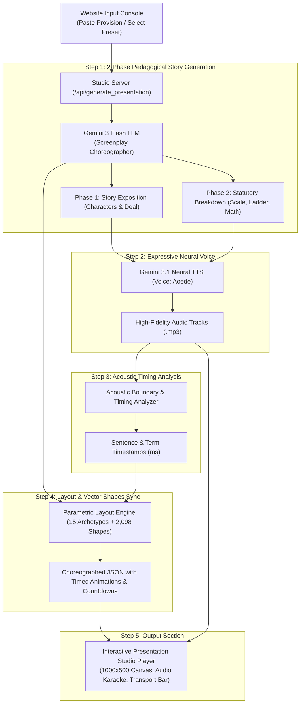

# Statutory Kinetic Presentation Studio 🎬⚖️

[](https://github.com/moviesua23-pixel/statutory-kinetic-studio/actions/workflows/ci.yml)
[](LICENSE)
[](https://www.python.org/downloads/)

An end-to-end automated educational lecture generation studio for Direct Tax (DT) and Indirect Tax (IDT). Paste any tax provision, bare act section, circular, or practical dispute, and the studio automatically choreographs a **2-Phase Pedagogical Story**, synthesizes teacher audio using **Gemini Expressive Voice (`gemini-3.1-flash-tts-preview`, voice `Aoede`)**, acoustically analyzes phrase timing, selects parametric layout archetypes & vector shapes, and renders an interactive, synchronized kinetic presentation in your browser.

---

## 🌟 Key Features

1. **Flexible Provision Input**:
   - Paste any raw statutory provision, rule, notification, or practical case study.
   - Pre-loaded with 5 comprehensive CA Final/Inter presets:
     * **Section 50C**: Stamp Duty Value Deemed Consideration & 110% Safe Harbor.
     * **Section 45(2)**: Conversion of Capital Asset into Stock-in-Trade (FMV timing rule).
     * **Section 54**: Long-Term Capital Gain Exemption & Combining Two Adjacent Flats (*CIT v. Ananda Basappa*).
     * **Section 54EC**: Capital Gain Bonds 6-Month Statutory Window & ₹50 Lakhs Ceiling.
     * **GST Section 16(2)**: Four Golden Conditions for Input Tax Credit (ITC).

2. **2-Phase Pedagogical Screenplay Architecture**:
   - **Phase 1: Story Exposition (Scenes 1 & 2)**: Real characters, Kerala/Indian city context, transaction history, and agreed amounts before touching statutory formulas.
   - **Phase 2: Point-by-Point Statutory Breakdown (Scenes 3 to 6)**:
     * *Valuation Dispute & 110% Safe Harbor* (`balance_scale`).
     * *Statutory Reinvestment Shield & Caps* (`timeline_window` or `shield_cards`).
     * *Section 48 Computation Ladder* (`waterfall_ledger` with arithmetic deductions & countdown amounts).
     * *Landmark Precedent & CA Exam Takeaways* (`spotlight_formula`).

3. **Gemini Expressive Neural Voice TTS**:
   - Primary: `gemini-3.1-flash-tts-preview` with prebuilt voice `Aoede` (or `Fenrir`, `Puck`, `Charon`).
   - Manglish code-switching standard: conversational Malayalam teacher scaffolding with statutory legal terminology in English per Universal Domain Principle.
   - Graceful fallback to `gTTS`.

4. **Acoustic Voice Timing & Word Karaoke Sync**:
   - Waveform silence and acoustic boundary detection to calculate sentence millisecond timestamps.
   - Screen elements, calculation rows, and badges animate on screen *the exact millisecond* the teacher speaks about them.

5. **Prominent Visuals & Animated Countdowns**:
   - **Font Zoom Controls**: Standard (100%), Prominent (+15%), Extra Large (+30%).
   - **Full Statutory Amounts**: Displayed in full Indian currency formatting (`₹1,00,00,000`, `₹1,25,00,000`, `₹50,00,000`).
   - **Odometer Countdown Effects**: Amounts count up/down dynamically as they appear.
   - **2,098 Dual-Tone Vector Shapes Library**: Houses, trucks, scales, gavels, calculators, shields, and badges.

---

## 🏗️ Architecture & Pipeline Flow



---

## 🚀 Quick Start Guide

### 1. Clone Repository & Install Dependencies
```bash
git clone https://github.com/moviesua23-pixel/statutory-kinetic-studio.git
cd statutory-kinetic-studio

# Create virtual environment
python -m venv venv
source venv/bin/activate  # On Windows: venv\Scripts\activate

# Install requirements
pip install -r requirements.txt
```

### 2. Configure Gemini API Key
Create a `.env` file in the root directory:
```env
GEMINI_API_KEY=your_gemini_api_key_here
# Or multiple keys for automatic rotation:
# GEMINI_API_KEYS=key1,key2,key3
```

### 3. Launch Studio Server
```bash
python server.py 8090
```
Open **`http://localhost:8090`** in your browser.

---

## 🧪 Running Automated Tests
```bash
python tests/test_pipeline.py
# Or with pytest:
# pytest tests/
```

---

## 📁 Repository Structure
```
statutory-kinetic-studio/
├── .github/
│   └── workflows/
│       └── ci.yml               # GitHub Actions Automated CI
├── pipeline/
│   ├── key_rotator.py           # Gemini API key rotator & error retry
│   ├── story_choreographer.py   # 2-Phase Pedagogical Screenplay generator
│   ├── voice_synthesizer.py     # Gemini Expressive Voice TTS (Aoede)
│   ├── timing_aligner.py        # Acoustic timing & layout element sync
│   └── orchestrator.py          # Master pipeline coordinator
├── static/
│   ├── index.html               # Dual-section Web Studio UI
│   ├── css/
│   │   └── studio.css           # Modern Tailwind-like layout styling
│   ├── js/
│   │   ├── studio.js            # Input handling & live workflow stepper
│   │   ├── layout_engine.js     # 15 Mathematical Spatial Archetypes
│   │   ├── colorful_shapes_library.js # 2,098 Vector Shapes Library
│   │   └── presentation_player.js   # Canvas presenter & karaoke audio player
│   └── data/
│       ├── colorful_shapes_data.json # 2,098 Vector icons definitions
│       └── preset_provisions.json   # 5 Preloaded CA Final/Inter provisions
├── tests/
│   └── test_pipeline.py         # Test suite for sentence splitting & timing
├── requirements.txt
├── server.py                    # Lightweight HTTP server with Range seeking support
└── README.md
```

---

## 📄 License
This project is licensed under the MIT License.
